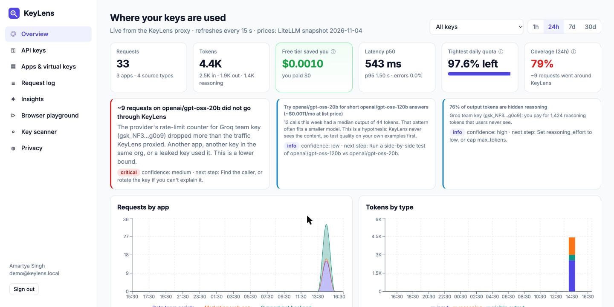
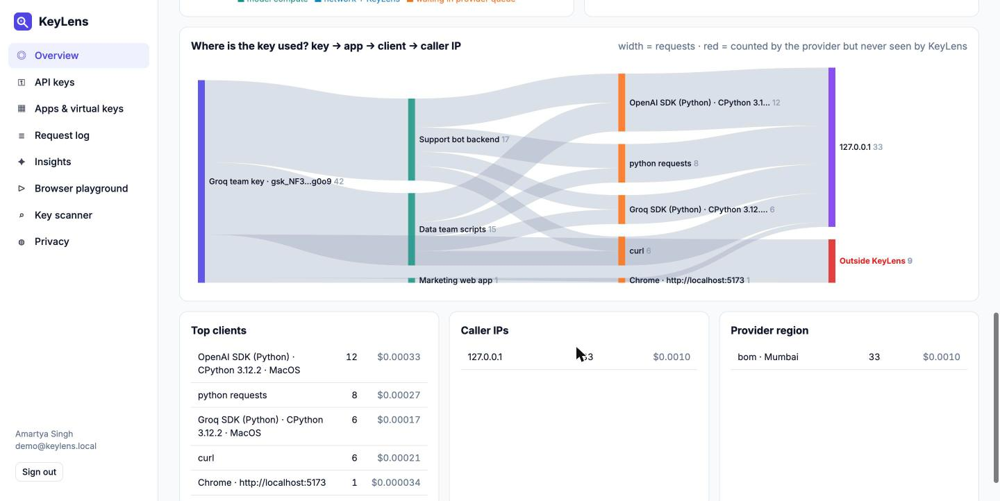
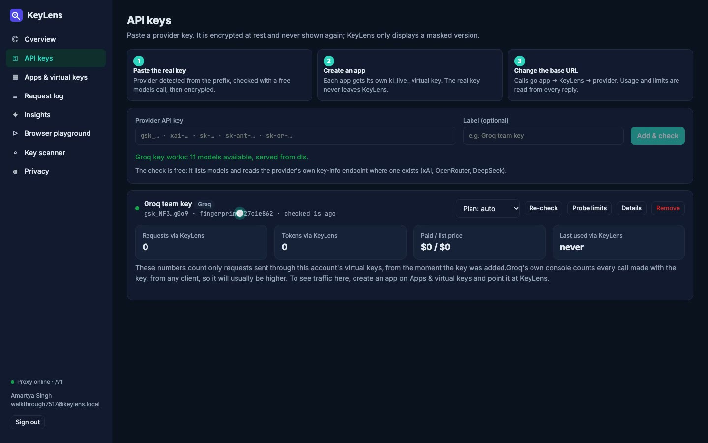

# KeyLens

**See where your LLM API keys are used.** Paste a Groq, xAI, OpenAI, Anthropic or
OpenRouter key and KeyLens shows which app used it, from where (browser, SDK
script, CLI, server), which model, how many tokens (including hidden reasoning
tokens), what it cost, what it *would* cost if you weren't on a free tier, how much
of your rate limit is left, and whether someone used the key **outside** KeyLens.

Metadata only. Prompt and response text are never stored, and a test proves it.



**Walkthrough video (3 min, real Groq traffic):** [`docs/KeyLens_Walkthrough.mp4`](docs/KeyLens_Walkthrough.mp4)

**Build write-up (4 pages, with design, results and limits):** [`docs/KeyLens_Build_Writeup.pdf`](docs/KeyLens_Build_Writeup.pdf)

KeyLens is the working v1 slice of a larger design (enterprise AI usage visibility:
see `docs/`). It answers one question end to end: *"I have an API key. Where is it
being used, and what is it costing me?"*

---

## Why a key alone is not enough

I started by asking how much a provider tells you about your own key. The answer
is: very little (full notes in [`docs/research.md`](docs/research.md)).

- Groq has no usage API at all. OpenAI and Anthropic only show per-key usage with a
  separate admin key. Only OpenRouter returns per-key totals to a normal key.
- **No provider tells a normal key holder *where* the key was called from.**

So KeyLens puts a thin layer in the path: every app gets its own **virtual key**
and points its base URL at KeyLens. KeyLens swaps in the real key, streams the
answer back untouched, and records metadata. That one config change (no code
change) is what makes "which app, which machine, which client" answerable.

Then it goes one step further: providers return rate-limit counters on every
response. Groq's daily request limit is a continuously refilling bucket
(`reset_seconds × limit / 86400` = requests spent). KeyLens simulates the same
bucket using only the traffic it proxied. **If the provider's bucket is emptier
than KeyLens's, someone used the key somewhere else.** In a live test, 9 requests
sent straight to Groq were reported as exactly 9 requests "outside KeyLens", with
0 false ghosts on the other model. Simulated buckets confirm it never over-counts.



## How the data is fetched

The keys page shows the same three steps:



1. **Paste the real key.** The provider is detected from the prefix, and the key is
   checked with a free models call, then encrypted. From then on it is only shown masked.
2. **Create an app.** It gets its own `kl_live_…` virtual key. The real key never
   leaves KeyLens.
3. **Change the app's base URL** to KeyLens. On every call KeyLens checks the
   endpoint, the pause switch and the budget, then swaps in the real key and
   streams the reply back untouched. Once the reply has gone, it reads the `usage`
   block and the rate-limit headers and saves one metadata row.

The numbers on a key card count only traffic sent through that account's virtual
keys. The provider's own console counts every call made with the key, so it is
usually higher. That difference is what the outside-usage check estimates.

## What it does

| | |
|---|---|
| **Paste a key** | Provider detected from the prefix (`gsk_`, `xai-`, `sk-`, `sk-ant-`, `sk-or-`), validated with free calls only, encrypted at rest (Fernet), shown masked forever after. |
| **Virtual keys per app** | One `kl_live_…` key per app, with copy-paste snippets for the OpenAI SDK, curl and env vars. Pause an app (kill switch) or give it a monthly budget without touching the real key. |
| **Where it's used** | Key → app → client → IP flow; client detection from headers: browser (Chrome · origin), OpenAI / Groq / Anthropic SDK with language, runtime and OS, curl, Postman, python-requests and more. |
| **Tokens and cost** | Input, visible output, hidden reasoning, cached tokens. Cost at list price from a LiteLLM price snapshot (732 models) vs what you actually paid (free tier = $0). xAI's own reported cost is used when present. |
| **Latency** | Total, time to first byte, and for Groq the split between waiting in the provider's queue and actual compute. |
| **Rate limits** | Daily request and per-minute token headroom per model, with a forecast of when the daily limit runs out at the current pace. |
| **Ghost usage** | Traffic the provider counted but KeyLens never saw: another app, another key in the org, or a leak. |
| **Insights** | Plain rules with a confidence level and a next step: ghost usage, quota forecast, cheaper model for short answers, hidden-reasoning share, queue-bound latency, error spikes, new caller IPs, free-tier value, unused keys. |
| **Key scanner** | Finds where a key sits on this machine (files, shell history), whether it is tracked by git or in git history, and rates the risk. Keys are only ever shown masked. |
| **Raw metadata** | Every request opens to the exact JSON that was stored: response headers, usage block, request parameters (numbers only). |

## Privacy, enforced

- No table has a column for prompt or response text.
- The proxy reads `model`, `stream` and numeric parameters from the request, and the
  `usage` block from the response. Messages are counted, never stored.
- `backend/tests/test_privacy.py` sends a unique canary prompt and reply through
  the proxy (streaming and non-streaming) and fails if either string appears
  anywhere in the database dump.

## Run it

Requirements: Python 3.11+, Node 20+.

```bash
# backend
cd backend
python3 -m venv .venv && .venv/bin/pip install -r requirements.txt
cp .env.example .env            # optional: set DEMO_GROQ_KEY for the demo script
.venv/bin/uvicorn app.main:app --port 8000

# frontend (second terminal)
cd frontend
npm install
npm run dev                     # http://localhost:5173
```

If port 5173 is taken, run `npx vite --port 5174` and add that origin to
`KEYLENS_CORS_ORIGINS` in `backend/.env`. The sidebar shows "Proxy online" once
the frontend can reach the backend.

Then: create an account → paste a key on **API keys** → create an app on
**Apps** → use its virtual key:

```python
from openai import OpenAI
client = OpenAI(base_url="http://localhost:8000/v1", api_key="kl_live_...")
client.chat.completions.create(model="openai/gpt-oss-20b",
                               messages=[{"role": "user", "content": "Hello"}])
```

The Groq SDK works too (`Groq(base_url="http://localhost:8000", api_key="kl_live_...")`).

Generate realistic traffic from several kinds of clients, plus a few calls that
skip KeyLens to see ghost detection:

```bash
cd backend
.venv/bin/python scripts/demo_traffic.py --vkey kl_live_A --vkey kl_live_B --rounds 2 --ghost 4
```

Run the tests (no network needed):

```bash
cd backend
.venv/bin/python tests/test_privacy.py      # canary prompt/reply never reach the database
.venv/bin/python tests/test_proxy_rules.py  # endpoint allowlist, kill switch, budget, Host check
.venv/bin/python tests/test_ghost.py        # ghost inference never over-counts
```

## Measured on a live Groq key

| | |
|---|---|
| Requests through KeyLens | 46, from 5 client types (OpenAI SDK, Groq SDK, python-requests, curl, Chrome) across 3 apps |
| Outside requests detected | 9 sent around KeyLens → 9 reported, 0 false; in the recorded walkthrough 3 → 3 |
| Hidden reasoning | 76% of output tokens on `gpt-oss` |
| Latency | median ~580 ms waiting in Groq's queue vs ~50 ms compute |
| Overhead added by KeyLens | ~48 ms median (network only, n = 6) |

## How it's built

```
frontend/  React + TypeScript + Vite + Recharts
  src/pages/   Overview, Keys, Apps, Requests, Insights, Playground, Scanner, Privacy
backend/   FastAPI + httpx + SQLite (no ORM)
  app/proxy.py       metadata-only streaming proxy (/v1/* and /openai/v1/*)
  app/providers.py   prefix detection, free key checks, provider facts
  app/ratelimits.py  header parsing, token-bucket ghost inference, forecast
  app/classify.py    request source classification
  app/pricing.py     list vs actual cost (bundled LiteLLM snapshot)
  app/insights.py    rule-based insight cards
  app/scanner.py     local key scanner with git checks
  app/api.py         dashboard API
  tests/             privacy canary, proxy rules, ghost math
docs/      research notes and the design write-up
```

## Limits (said plainly)

- KeyLens only sees traffic routed through it. Ghost usage is an *estimate* from
  provider counters, and those counters are per organization and model, so it
  can't say *which* other key or app made the calls.
- Source labels come from headers; any client can fake a User-Agent.
- Cheaper-model suggestions are hypotheses: KeyLens never sees content, so it
  can't judge quality. Test before switching.
- Ghost inference needs a long request window (Groq's per-day limit) and sees
  outside calls only within the refill time (~86 s per request at 1,000/day).
- Only Groq was tested live. xAI, OpenAI, Anthropic and OpenRouter use the same
  code paths but were not called with real keys.

## License

MIT
